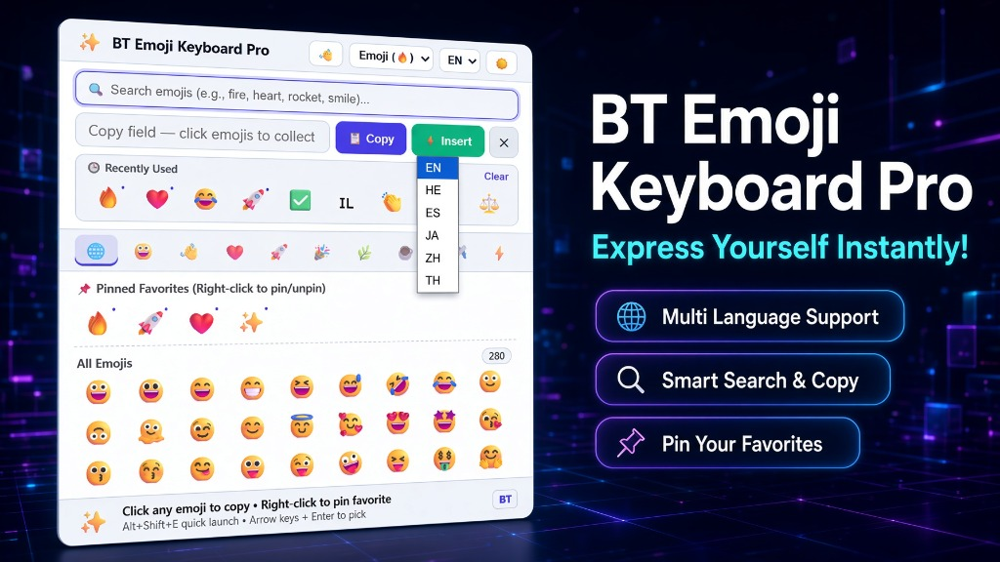

# ✨ BT Emoji Keyboard Pro — Instant Copy & Insert (EN / HE / ES / JA / ZH / TH)

**BT Emoji Keyboard Pro** is an ultra-fast, lightweight **Manifest V3** Chrome Extension built by **[BrandTactics](https://brandtactics.co.il)** for instant 1-click emoji copying, multi-emoji staging, and direct insertion into any active web page text field (`<input>`, `<textarea>`, or `contenteditable`).

- **GitHub Repository**: [https://github.com/sagive/bt-emojie-keyboard](https://github.com/sagive/bt-emojie-keyboard)
- **Developer Website**: [https://brandtactics.co.il](https://brandtactics.co.il)

---

## 🚀 Key Features

1. **6-Language Native Localization (`EN`, `HE`, `ES`, `JA`, `ZH`, `TH`)**:
   - **EN (English — Default)**
   - **HE (עברית — Full RTL layout & Hebrew slang search)**
   - **ES (Español — Argentina)**
   - **JA (日本語 — Japanese)**
   - **ZH (中文 — Chinese)**
   - **TH (ไทย — Thai)**
   - Every tooltip, category title, search index, and bottom inspector description adapts strictly to the selected language with zero cross-language clutter.
2. **Optimized 3-Tier Top Workflow**:
   - **🔍 Auto-Focus Search Field**: Filter 280+ curated emojis, symbols, and ready-made combos in `<2ms`.
   - **📋 Persistent Copy & Insert Field**: Every click appends the emoji to the Copy Field and copies it immediately to your clipboard, with 1-click **Copy**, **Insert into active page**, and **Clear** buttons.
   - **🕒 Pinned "Recently Used" Bar at Top**: Your 9 most recent emojis are always 1 click away right below the Copy Field.
3. **📌 Right-Click Pinned Favorites & ⚡ Smart Combos / Kaomoji**:
   - Right-click any emoji to pin/unpin it to your personal Favorites grid.
   - Includes ready-to-use multi-emoji combos (`🚀🔥💯`, `🙏❤️🇮🇱`, `✅🎯📈`, `👏🏆🥇`) and Kaomoji (`¯\_(ツ)_/¯`, `(╯°□°)╯︵ ┻━┻`).
4. **4 Copy Formats & 6 Fitzpatrick Skin Tones**:
   - Copy as native `Emoji (🔥)`, `:shortcode:`, `U+HEX` Unicode, or `&#xHEX;` HTML Entity.
   - Clean Light Theme by default with instant Light/Dark (`☀️ / 🌙`) toggle and uniform `44x44px` 9-column square grid (`480x595` popup).
5. **100% Privacy-First (Zero `<all_urls>` Host Permissions)**:
   - Runs 100% offline with zero telemetry, zero remote scripts, and minimal Manifest V3 permissions (`storage`, `activeTab`, `scripting`, `clipboardWrite`, `contextMenus`).

---

## 🛠️ Local Installation (`Load unpacked`)

1. Open Chrome and navigate to `chrome://extensions/`
2. Enable **Developer mode** (top-right toggle).
3. Click **Load unpacked** and select this project folder (`D:\Websites\Chrome\bt-emojie-keyboard`).
4. Press `Alt+Shift+E` (or click the toolbar icon) to launch!
